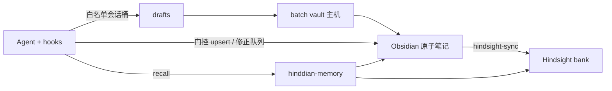

# Obsidian SoT + Hindsight 索引（现行）

> **已改写（2026-10-18）**。旧「双管线并行、会话原文 retain、Magpie 直连 hindsight」作废。权威：仓库 [`ARCHITECTURE.md`](https://github.com/wyq0x55/hinddian/blob/main/ARCHITECTURE.md)。

## 角色

| 系统 | 角色 | 写入 | 读取 |
|------|------|------|------|
| **Obsidian vault** | 人读 **SoT** | hooks 草稿→batch；门控 upsert | Obsidian App / LiveSync |
| **hinddian-memory** | Agent 唯一记忆 API | `push_draft` / 门控 upsert（非 retain） | `recall` 等 |
| **Hindsight** | **仅索引** | **仅** sync timer（active 笔记） | 经 hinddian-memory recall，不对 Agent 暴露 retain |

## 示意



## 端点（无密钥）

| 用途 | 地址 |
|------|------|
| hinddian-memory 公网 | `https://<api-host>:8444/hinddian/mcp` |
| Hindsight API 本机（API 主机） | `http://127.0.0.1:8888` |
| Jev / Magpie | 本机或隧道 `127.0.0.1:3425` |

## 运维

```bash
# API 主机
systemctl status hinddian magpie-tunnel hinddian-hindsight-sync.timer
# 不要再依赖 hindsight-retain.timer 吃会话原文作为主路径
```
